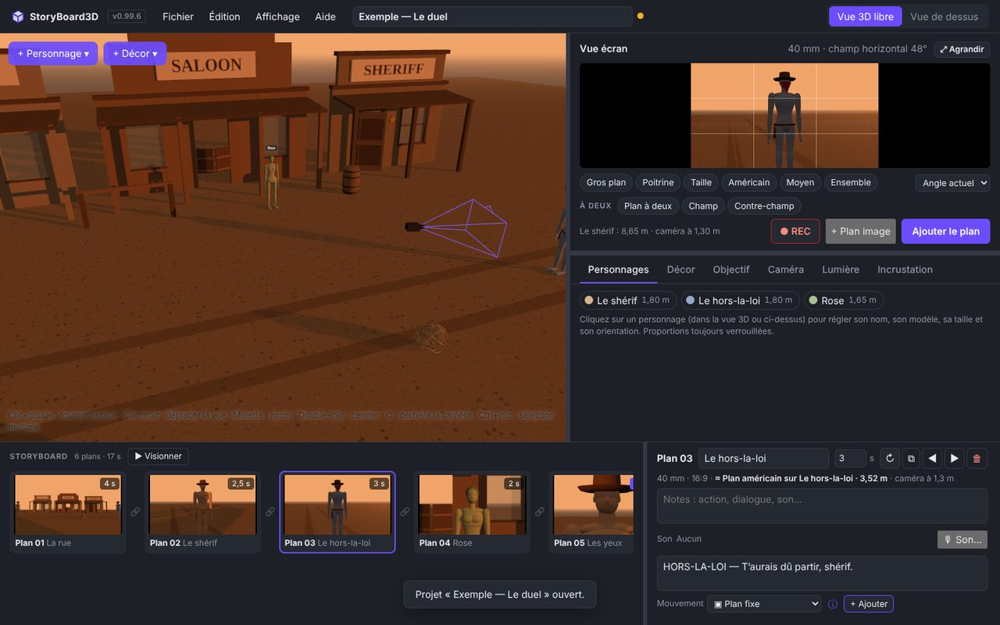
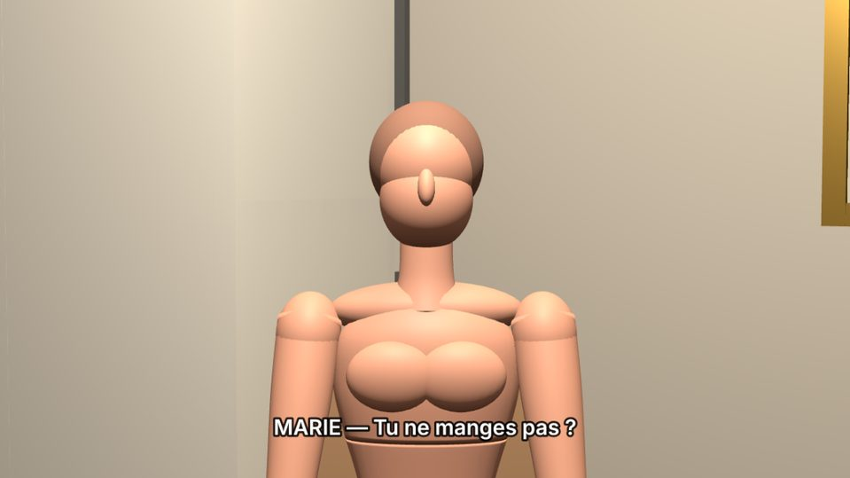
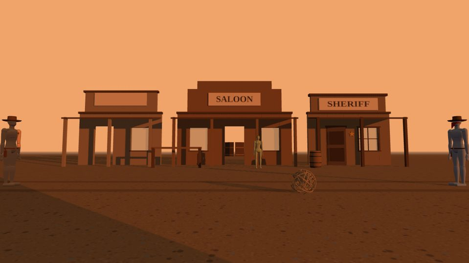
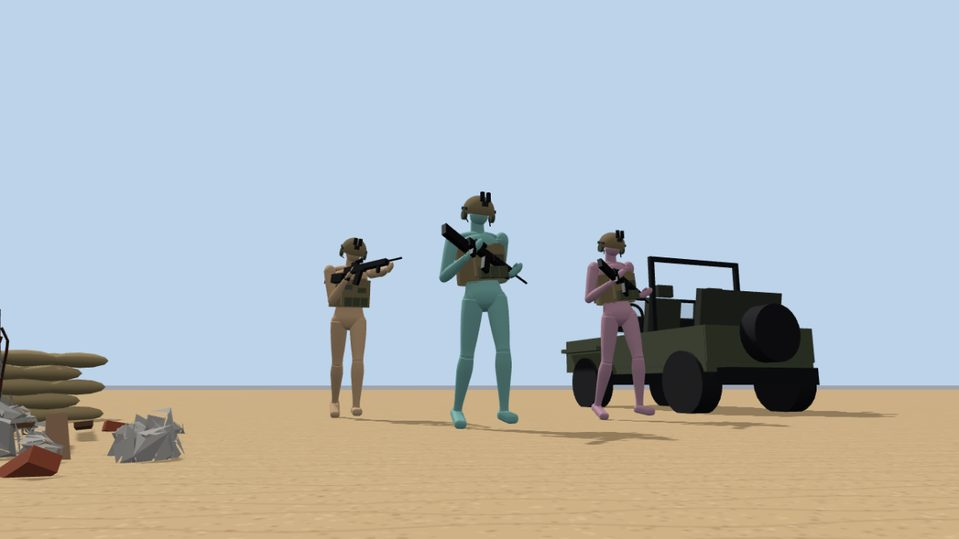
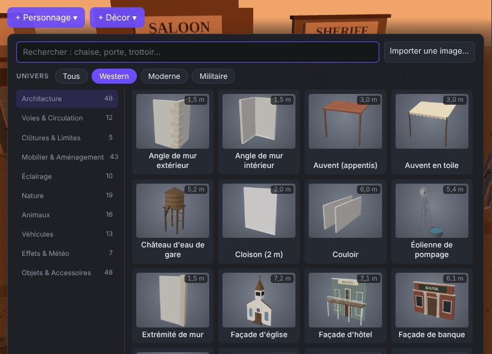
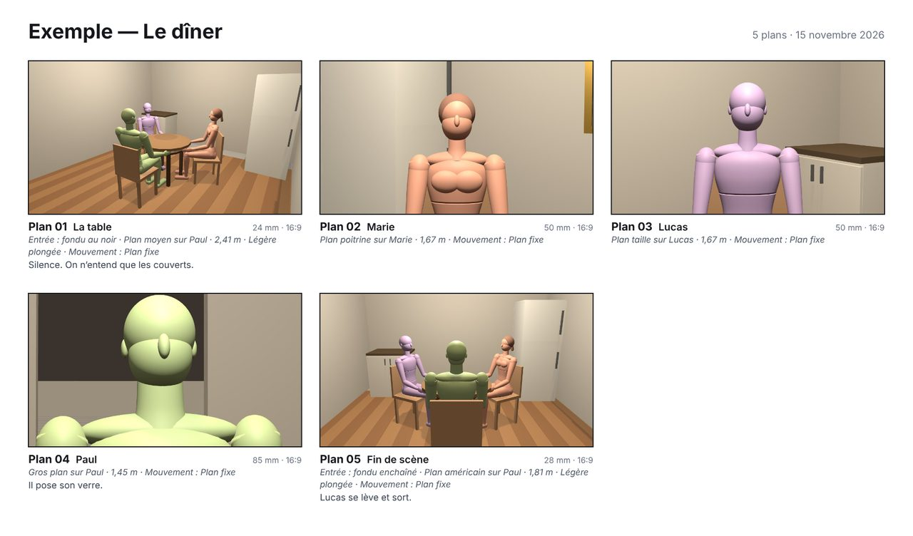

# StoryBoard3D

**Préparez vos plans en 3D avant le tournage.**

StoryBoard3D est un outil de storyboard pour scénaristes, réalisateurs et équipes de tournage : on pose un décor et
des personnages à l'échelle réelle, on cadre avec une vraie caméra (focales, hauteur, plongée), on enregistre chaque
plan, puis on imprime la planche, on l'exporte en PDF ou on en fait une animatique vidéo avec le son.

Le but n'est pas l'image finale du film, mais l'idée du plan : la composition, la valeur de cadre, la place des
personnages, la lumière et le mouvement de caméra — de quoi préparer un découpage technique et le partager avec
l'équipe.

**[⬇ Télécharger pour Windows](../../releases/latest)** — gratuit, en français, Windows 10 et 11.

---

## Des plans comme au tournage

| | |
|---|---|
|  |  |
|  |  |

## Ce que l'on peut faire

- **Une scène à l'échelle 1:1** : sols (herbe, sable, terre, pavés, neige, eau), grille d'un mètre, décors aux
  dimensions réelles.
- **Des personnages posables** : homme, femme, adolescents, enfants, bébé. Poses prêtes à l'emploi (debout, marcher,
  courir, sauter, accroupi, à genoux, allongé, en garde…), réglage articulation par articulation et bibliothèque
  « Mes poses ». Ils s'assoient sur les sièges, se couchent dans les lits, montent en voiture, en bateau, à cheval
  ou dans un cockpit.
- **Des objets en main qui donnent la pose** : tasse, téléphone, micro, appareil photo, jumelles, armes, outils,
  bébé dans les bras… et, si besoin, le geste seul sans l'objet.
- **Une caméra aux focales réelles** : de l'ultra grand-angle au téléobjectif, plans assistés (gros plan, plan
  américain, plan d'ensemble, plan à deux, champ / contre-champ), mouvement de caméra enregistré (REC).
- **Le storyboard** : chaque plan garde sa caméra, ses personnages, ses décors et sa lumière ; nom, durée, notes,
  transitions (cut, fondu, enchaîné), sous-titres de dialogue, son du plan (enregistré au micro ou importé),
  cartons titres.
- **Visionner** : les plans s'enchaînent comme un film, avec le son et les sous-titres.
- **Partager** : planche imprimée, PDF ou PNG, planche à annoter, liste des plans pour le tableur, animatique vidéo
  MP4 avec le son.
- **Plus de 360 décors** répartis en trois univers :
  - **Western** : rue de l'Ouest, saloon, banque, prison, gare et train à vapeur, diligence, ranch, chevaux, canyon…
  - **Moderne** : immeubles, rues, carrefours, voitures (dont une voiture filmable de l'intérieur), bus, camions,
    intérieurs complets (cuisine, salle de bain, bureau…), cockpit d'avion de ligne, bateaux, mobilier urbain.
  - **Militaire** : équipement du soldat, véhicules, hélicoptères, cockpit d'avion de chasse, base, village,
    dégâts et ruines.
- **La lumière et l'ambiance** : jour, nuit, intérieur, coucher de soleil, orage, contre-jour ; projecteurs,
  lampes et phares qui éclairent vraiment ; pluie, neige, brouillard ; fumée, feu, explosion ; image en noir et
  blanc ou sépia.
- **Vos images** : photos de repérage, toiles de fond, affiches, à poser dans la scène.

## La planche

## Pour commencer

À la première ouverture, le guide **Premiers pas** présente l'application en sept écrans. Trois projets d'exemple
sont livrés avec elle (**Fichier › Ouvrir un exemple**) : un dîner en intérieur avec dialogue, un duel western au
coucher du soleil, une patrouille militaire. **Aide › Astuces** et **Aide › Raccourcis clavier** aident à aller
plus vite.

## Installer

1. Dans **[Releases](../../releases/latest)**, téléchargez le fichier `StoryBoard3D-Setup-x.y.z.exe` de la dernière
   version.
2. Lancez-le. L'application n'étant pas signée numériquement, Windows peut afficher « Windows a protégé votre
   ordinateur » : cliquez sur **Informations complémentaires**, puis sur **Exécuter quand même**.
3. Suivez l'installation. Un raccourci StoryBoard3D est créé sur le bureau et dans le menu Démarrer ; les fichiers
   de projet `.sb3d` s'ouvrent d'un double-clic.

## Mises à jour

Une fois installée, l'application se tient à jour d'elle-même : au démarrage, elle propose la nouvelle version
quand il y en a une (**Installer et redémarrer**), ou on la cherche via **Aide › Rechercher une mise à jour**.
Le travail en cours est sauvegardé et rouvert tel quel après la mise à jour.

## Configuration

- Windows 10 ou 11, 64 bits.
- Une carte graphique récente est conseillée pour les grandes scènes (éclairage de nuit, ombres, nombreux décors).

## À savoir

StoryBoard3D est en développement actif : de nouveaux décors et de nouvelles fonctions arrivent régulièrement.
Les projets enregistrés restent compatibles d'une version à l'autre. L'application est en français.
